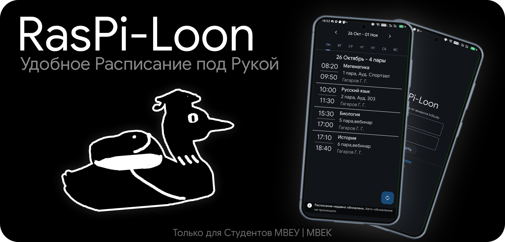

# 📘 RasPi-Loon

<picture>
    
</picture> 

**Удобное приложение для просмотра расписания МВЕУ**  
[📥 Скачать | 📃 Релизы](https://github.com/ilyagagara/raspi-loon/releases)
> Приложение создано только для сайта InStudy - disto.mveu.ru (учащихся в МВЕУ | МВЕК)

## 💡 Преимущества
- Расписание можно смотреть без интернета.
- Не нужно заходить в браузер и входить в аккаунт каждый раз, чтобы посмотреть расписание
- Код приложения полностью открыт

## ℹ️ Как Приложение Работает
- Сначало потребуеться **почта** и **пароль** от вашего аккаунт InStudy
- Приложение будет за вас авторизоваться в аккаунт и получать расписание, сохраняя его копию.
- Таким образом вам не придеться подключаться к интернету и входить лишний раз в аккаунт.

## 🔎 Что Появиться в Будущем
- Просмотр дневника
- Уведомления о новых оценках
- Уведомления о изменениях в расписаниях
- Напоминание о паре или вебинаре

## 🔒 Важные Примечания:
- **Данные** от вашего аккаунта **хранятся исключительно на вашем устройстве**.
- Приложение делает **запросы только на сайт disto.mveu.ru**, не передавая данные 3-им лицам
- *Я хотел использовать запрос на timeo.mveu.ru, чтобы не требовать пароль и почту, но он был приостановлен на момент создания (24 октября) и говорят, что он может перестать работать вовсе.*
- Приложение весит **100МБ+** из-за того, что оно написано на **python**. Он очень удобен и понятен, так что я выбрал его
и библиотеку **Flet**, которая позволяет создавать программы

## 📚 Библиотеки | Модули:
- [Flet](https://github.com/flet-dev/flet/)
- [requests](https://pypi.org/project/requests/)
- [beautifulsoup4](https://pypi.org/project/beautifulsoup4/)